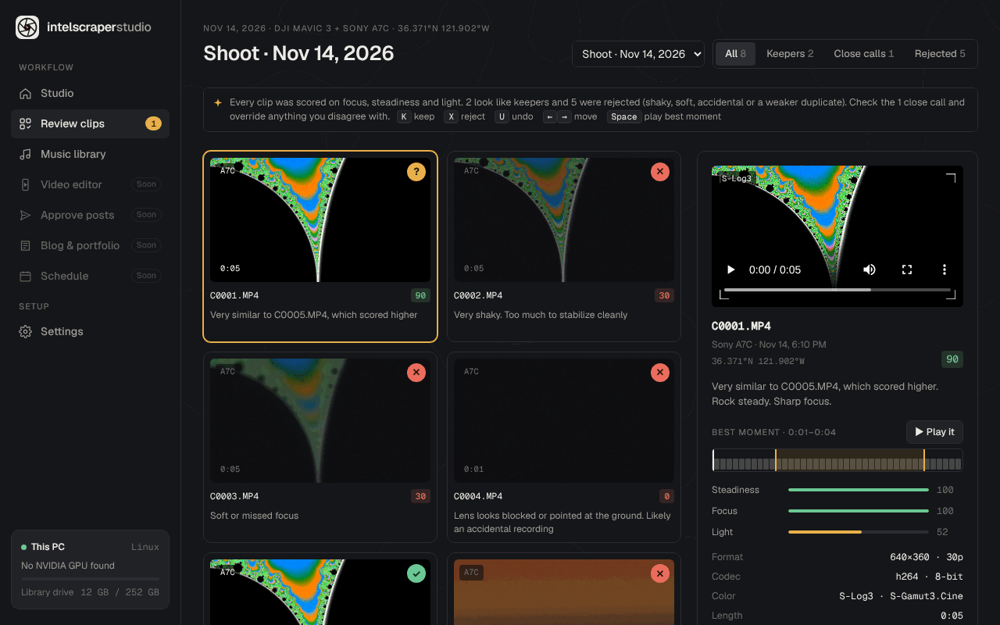
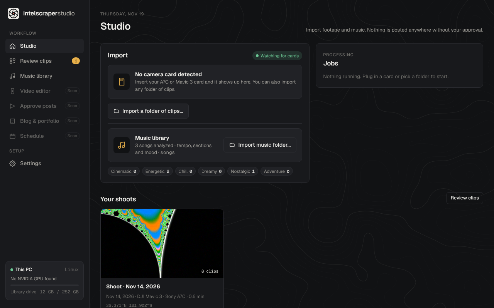
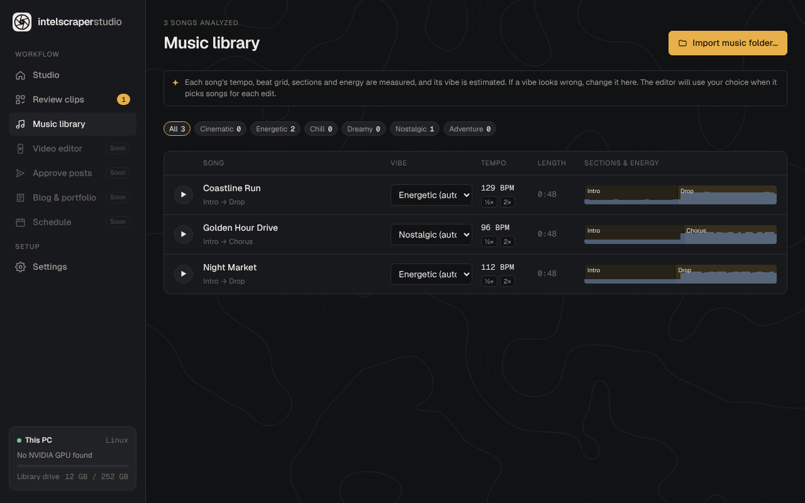
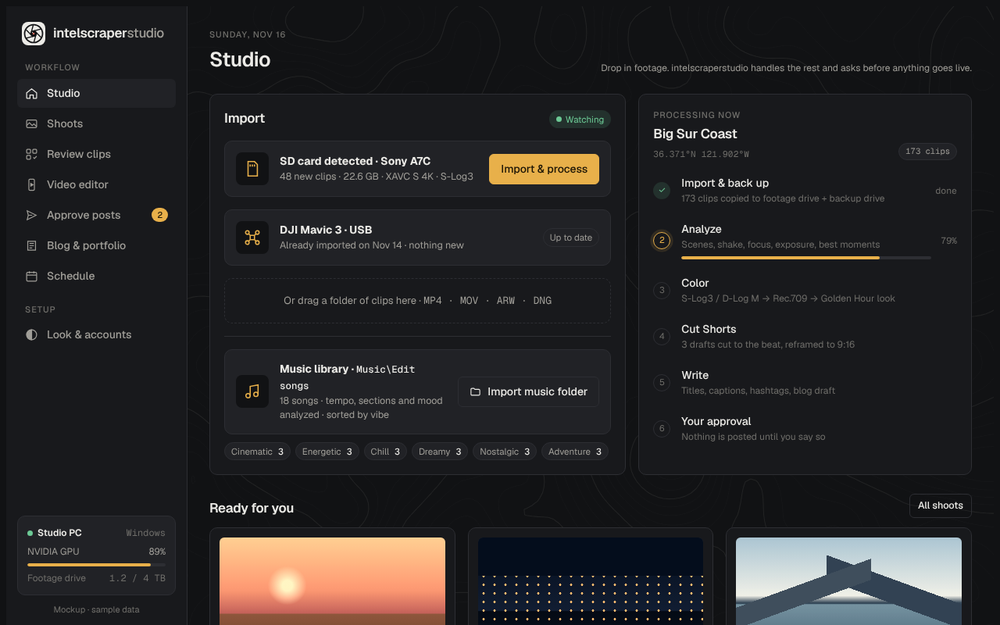

<p align="center"></p>

<h1 align="center">intelscraperstudio</h1>

<p align="center"><b>A local studio app for photographers and videographers</b>: import and back up camera cards, score every clip, analyse your music library, and (next) cut edits to it.</p>

<p align="center"></p>

A personal studio app for photographers and videographers. You shoot, then drop in the raw
footage. It imports and backs up your cards, scores every clip, learns your music library, and
(in later steps) cuts Shorts, Reels and YouTube videos to your music, writes the captions, and
publishes only after you approve.

Built for a Windows PC with an NVIDIA GPU, a **Sony A7C** and a **DJI Mavic 3**, but works with
any camera that records MP4/MOV.

> **Status: step 1 of 4 is working.** Footage import, clip review and the music library are
> built and tested. The editor, approvals, blog and scheduling are designed (see the mockup)
> and come next. See [docs/PLAN.md](docs/PLAN.md).

## What works today

**Import**
- Detects camera cards when you plug them in (Sony `PRIVATE/M4ROOT`, DJI/any `DCIM`).
- Copies footage into your library folder plus an optional backup folder on another drive.
- Hashes every file while copying, then re-reads each copy to verify it.
- Skips anything already imported, so importing the same card twice is harmless.
- Never changes, renames or deletes anything on the card.
- Groups clips into shoots by time, so one evening of A7C and drone footage becomes one shoot.

**Metadata.** Reads camera model, S-Log3 / D-Log M color profile, GPS, ISO, shutter, aperture,
altitude and record time. Sources are the Sony XML and DJI SRT sidecar files the cameras write
next to each clip.

**Clip scoring.** Each clip is scored 0–100 on three things:
- **Focus:** sharpness with sensor noise filtered out.
- **Steadiness:** frame-to-frame camera jitter. A smooth pan or drone move is not counted as shake.
- **Light:** under- or overexposure and clipped highlights. Flat log footage is judged on its own terms.

From those scores, each clip is:
- given a verdict: keep, close call or reject, with plain-English reasons;
- given a **best moment**, the 3–8 second window with the best quality;
- compared with similar takes; near-duplicates are flagged and only the best is kept automatically;
- shown with a thumbnail and a 540p preview file for smooth playback. On a log clip, both get a quick contrast boost so it's easier to judge.

**Review clips.** A grid of clips with a detail panel and video preview. Keyboard shortcuts:
- <kbd>K</kbd> keep
- <kbd>X</kbd> reject
- <kbd>U</kbd> go back to the engine's call
- <kbd>←</kbd> <kbd>→</kbd> move between clips
- <kbd>Space</kbd> play the best moment

**Music library.** Import a folder of songs. Each one gets:
- tempo and beat grid, with half- and double-time readings corrected automatically and ½×/2× buttons in case it's still wrong;
- an energy curve;
- sections (Intro, Verse, Build, Chorus, Drop, Bridge, Outro);
- an estimated vibe (Cinematic, Energetic, Chill, Dreamy, Nostalgic, Adventure) that you can change.

## Screenshots

| | |
|---|---|
|  |  |
| **Studio**: card watcher, import buttons, music vibe counts and the imported shoot (8 clips from an A7C and a Mavic 3 card). | **Music library**: tempo, vibe and the section/energy strip for each analysed song. |
|  | |
| **Design mockup** (`docs/design/mockup.html`, sample data): the planned processing pipeline and later steps. Not built yet. | |

The app screenshots use synthetic footage and songs made with the test suite's FFmpeg helpers
(`engine/tests/conftest.py`): steady, shaky, blurry, accidental and near-duplicate clips with Sony XML and DJI SRT sidecars.
This is why the hero shows a fractal test scene rather than real footage.

## Run it on Windows

1. Install **Python 3.11+** from <https://www.python.org/downloads/>. Tick *Add python.exe to PATH*.
2. Install **FFmpeg**:
   ```bash
   winget install Gyan.FFmpeg
   ```
3. Double-click **`run.bat`**. The first run installs dependencies, which takes a few minutes. Your browser then opens the app at <http://127.0.0.1:8765>.
4. In **Settings**, choose your library folder and, ideally, a backup folder on a second drive.

The app runs only on your PC. The server listens on `127.0.0.1`, so other devices can't reach
it, and footage never leaves your machine.

Command-line options (from the repo folder, with `PYTHONPATH=engine`):

```bash
python -m iss import "E:\"
```

```bash
python -m iss music "C:\Users\you\Music\Edit songs"
```

## Run it on macOS / Linux

Install Python 3.11+ and FFmpeg (macOS: `brew install ffmpeg`), then from the repo folder:

```bash
./run.sh
```

The first run creates `.venv` and installs `requirements.txt`. The app then serves on <http://127.0.0.1:8765>.
`run.sh` passes extra flags through to `python -m iss serve`, which accepts `--port` and `--no-browser`.

## Where things are stored

| What | Where |
|---|---|
| Imported footage (+ sidecars) | Library folder → `YYYY/YYYY-MM-DD/<camera>/` |
| Backup copy | Backup folder, same layout |
| Catalog, thumbnails, preview files | `%USERPROFILE%\.intelscraperstudio\` (`~/.intelscraperstudio/` on macOS/Linux; override with `ISS_HOME`) |
| Settings | `%USERPROFILE%\.intelscraperstudio\config.json` |

## Development

```bash
python -m venv .venv
```

```bash
.venv/bin/pip install -r requirements-dev.txt
```

```bash
.venv/bin/python -m pytest
```

The tests generate synthetic camera cards with FFmpeg: steady, shaky, blurry, smooth-pan,
accidental and near-duplicate clips, plus Sony XML and DJI SRT sidecars. They also generate
songs at known tempos. That way the import, scoring and music analysis are checked against
known answers.

## Structure

```
engine/iss/
  media.py     metadata: ffprobe + Sony XML + DJI SRT
  ingest.py    card detection, verified copy, dedupe, shoot grouping
  analyze.py   focus / steadiness / light, best moment, duplicates, thumbs, proxies
  music.py     tempo, beats, energy, sections, vibe
  server.py    local API (FastAPI) + serves the UI
web/           the interface (no build step)
docs/design/   clickable mockup of the full app
docs/PLAN.md   the build plan
docs/screenshots/  README images
run.bat / run.sh   launchers (Windows / macOS + Linux)
```
